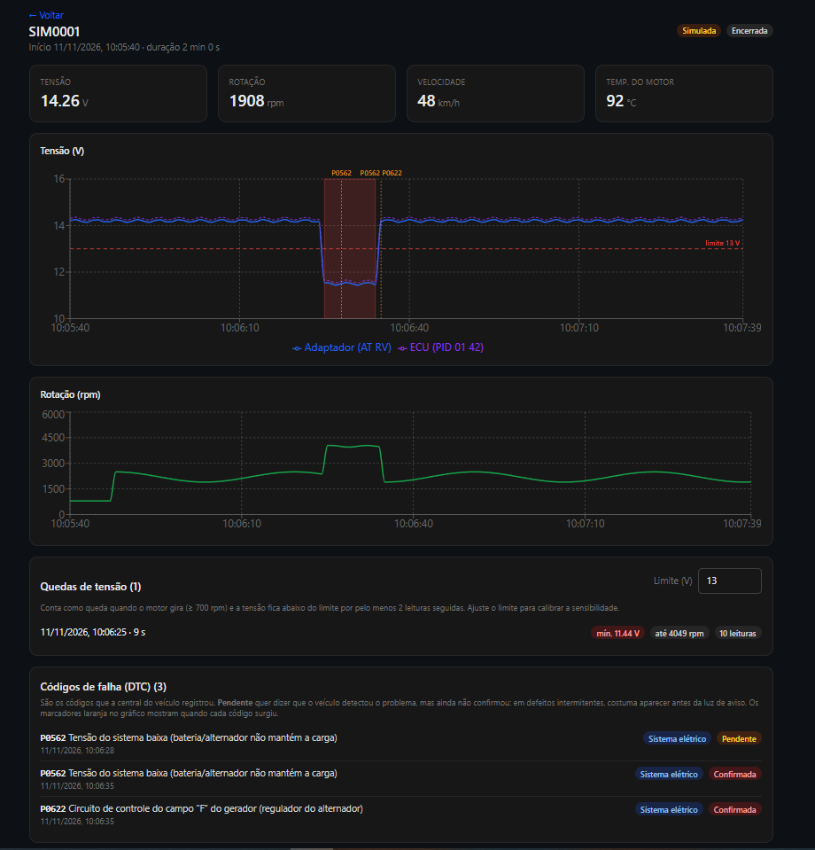
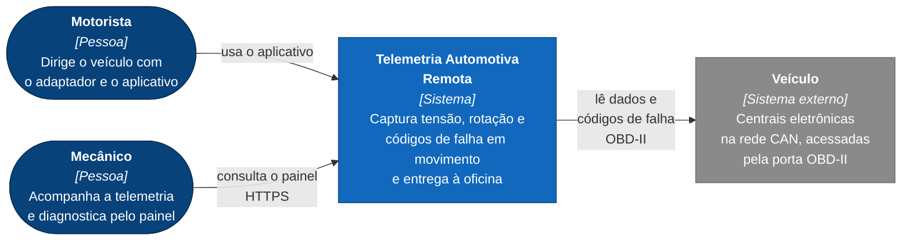
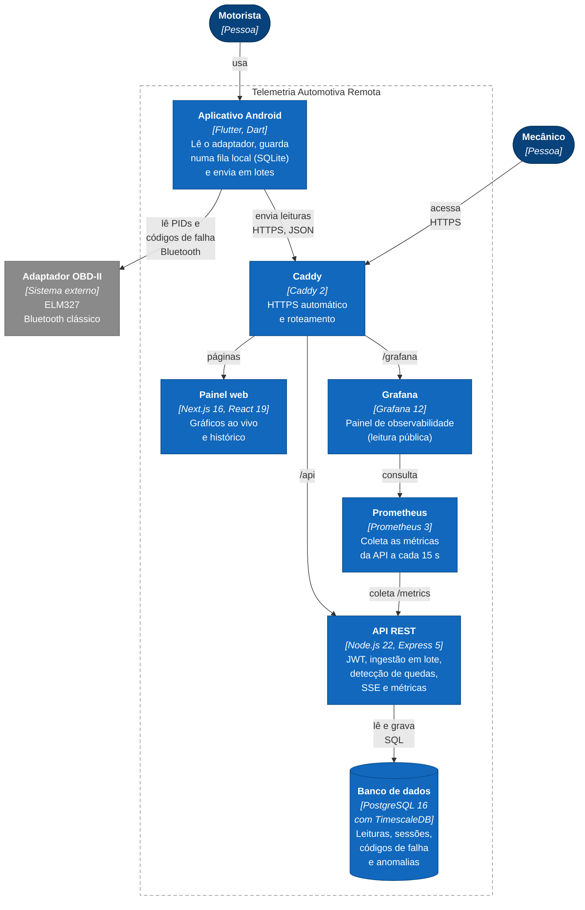
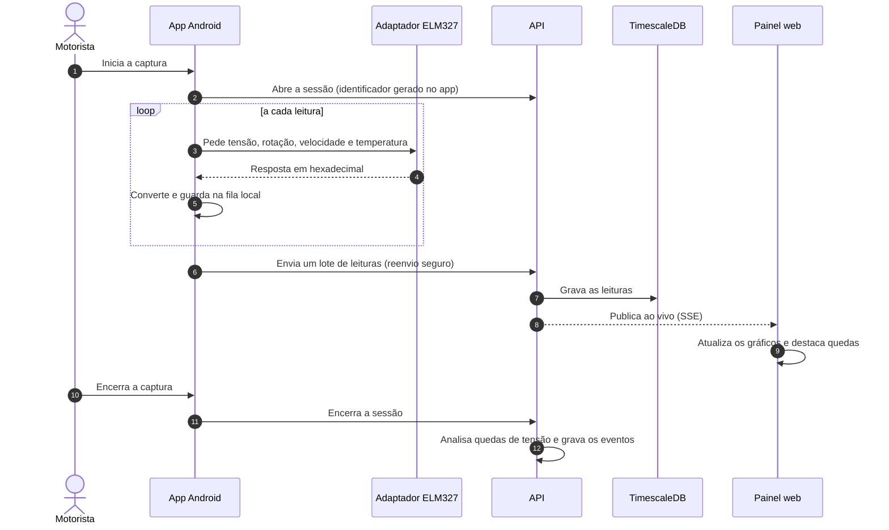
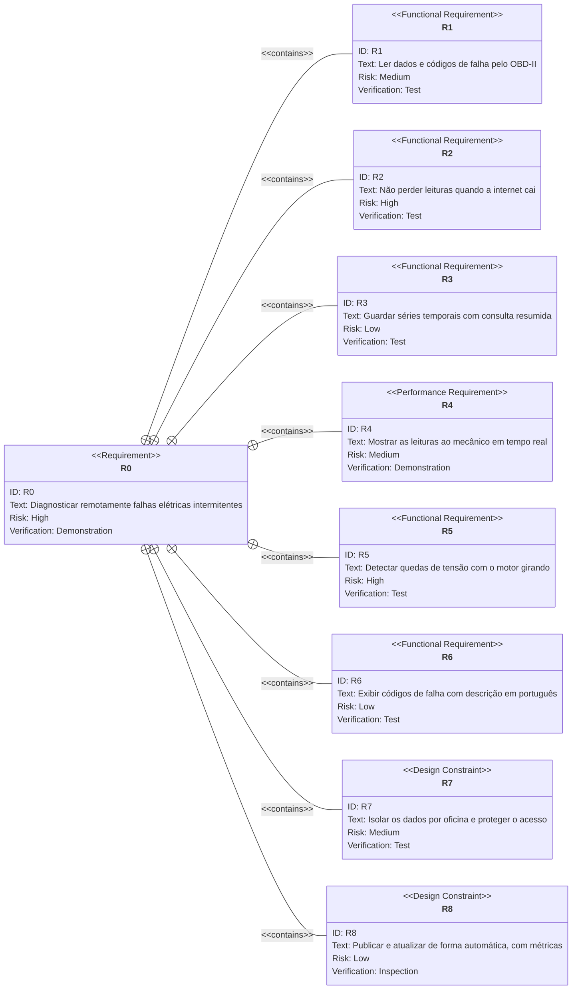
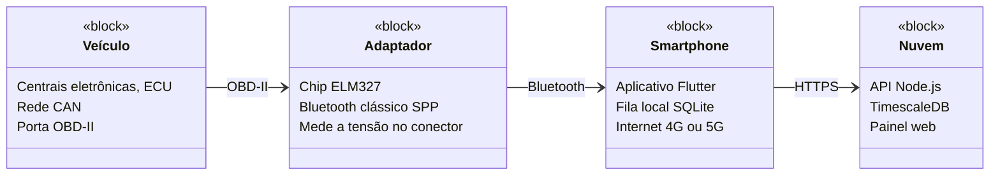
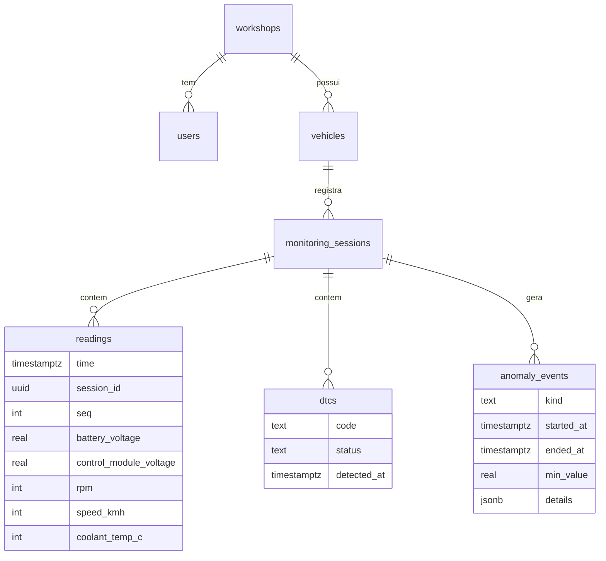
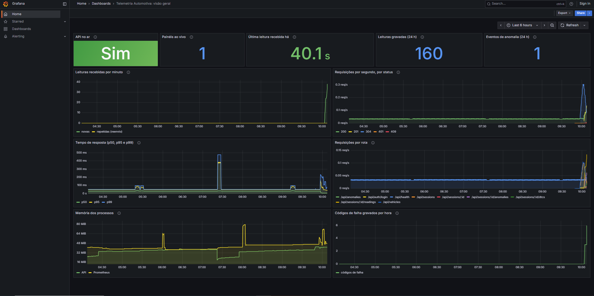

# Telemetria Automotiva Remota

[](https://github.com/SamuelMorsch/telemetria-api/actions/workflows/ci.yml)
[](https://sonarcloud.io/summary/new_code?id=SamuelMorsch_telemetria-api)
[](https://sonarcloud.io/summary/new_code?id=SamuelMorsch_telemetria-api)

Sistema de telemetria que leva a oficina para dentro do carro em movimento. Um adaptador OBD-II
no veículo, um aplicativo no celular do motorista e um painel web para o mecânico permitem
**diagnosticar à distância defeitos elétricos intermitentes**, como uma queda momentânea na
geração do alternador, que desaparecem quando o carro chega parado à oficina.

Trabalho de Conclusão de Curso de Engenharia de Software (Católica SC, 2026) · Autor: Samuel Morsch

> **Este é o repositório principal.** Ele contém a API e concentra a documentação do sistema
> inteiro (arquitetura, requisitos, decisões e operação). O aplicativo e o painel têm repositórios
> próprios, com instruções específicas.

## Demonstração

<p align="center">
  <a href="https://www.youtube.com/watch?v=qViO-gN4CwU">
    
  </a>
  <br>
  <a href="https://www.youtube.com/watch?v=qViO-gN4CwU">▶️ <b>Assista ao vídeo do sistema funcionando em um carro</b></a>
</p>

**Sistema no ar:** https://telemetria-tcc.duckdns.org · **Documentação interativa da API:** [`/api/docs`](https://telemetria-tcc.duckdns.org/api/docs) · **Observabilidade:** [`/grafana`](https://telemetria-tcc.duckdns.org/grafana/)



_Painel web com uma sessão **simulada** (marcada como "Simulada"): o alternador cai de 14 V para 11,5 V a ~4000 rpm, a queda aparece destacada no gráfico e os códigos de falha vêm com a descrição em português._

## Índice
[O problema](#o-problema) · [Ecossistema](#ecossistema) · [Arquitetura](#arquitetura) ·
[Requisitos](#requisitos) · [Como funciona](#como-funciona) · [API](#api) ·
[Segurança](#segurança) · [Qualidade](#qualidade) · [Operação](#operação) ·
[Rodando localmente](#rodando-localmente) · [Validação](#validação) · [Contribuindo](#contribuindo)

## O problema
Defeitos elétricos intermitentes só aparecem com o carro em movimento, sob carga, vibração ou
calor. Na oficina, com o veículo parado e ligado a um scanner, a falha não se repete, o que
gera diagnósticos inconclusivos, troca desnecessária de peças e clientes insatisfeitos.

**A proposta:** capturar tensão, rotação, velocidade, temperatura e códigos de falha **enquanto o
carro circula**, usando o celular do motorista como ponte de internet, e mostrar tudo em tempo
real ao mecânico, que passa a ter um "multímetro virtual e remoto".

## Ecossistema

| Módulo | Função | Tecnologia | Repositório |
|---|---|---|---|
| **App Android** | Lê o adaptador OBD-II, guarda na fila local e envia | Flutter | [telemetria_obd2_app](https://github.com/SamuelMorsch/telemetria_obd2_app) |
| **API** (este) | Recebe, guarda, detecta quedas de tensão e transmite ao vivo | Node.js 22, Express 5 | [telemetria-api](https://github.com/SamuelMorsch/telemetria-api) |
| **Painel web** | Gráficos em tempo real e histórico para a oficina | Next.js 16, React 19 | [painel-telemetria-web](https://github.com/SamuelMorsch/painel-telemetria-web) |

## Arquitetura

### Contexto (C4, nível 1): quem usa e o que o sistema toca


### Contêineres (C4, nível 2): o que roda onde


### Fluxo dos dados


### Por que esta arquitetura
- **O celular como ponte (gateway de borda).** Elimina um módulo com chip de celular dedicado
  no carro: o adaptador custa pouco e a conectividade já existe no bolso do motorista.
- **Fila local e envio em lotes idempotentes.** O sinal de celular falha em estrada. O app guarda
  tudo no aparelho e reenvia sem duplicar dados (a chave `(sessão, seq, tempo)` é única).
- **Banco de série temporal.** O volume é de leituras por segundo; o TimescaleDB resume longos
  históricos no próprio banco.
- **SSE em vez de WebSockets.** O fluxo é só do servidor para o painel; SSE usa HTTP comum,
  passa pelo proxy e reconecta sozinho.
- **Observabilidade enxuta.** Prometheus e Grafana rodam na mesma máquina de 1 GB, com limite de memória
  de 160 MB e 192 MB, e o painel é um arquivo versionado no repositório (`infra/grafana`).
- **Sem plataformas "tudo pronto".** Banco, autenticação e API são controlados por este projeto
  (ver [ADR 0001](docs/adr/0001-banco-proprio-em-vez-de-supabase.md)).

Todas as decisões, com contexto e consequências, estão em [`docs/adr`](docs/adr):

| ADR | Decisão |
|---|---|
| [0001](docs/adr/0001-banco-proprio-em-vez-de-supabase.md) | PostgreSQL/TimescaleDB próprio em vez de Supabase |
| [0002](docs/adr/0002-caddy-como-proxy-https.md) | Caddy como proxy reverso e HTTPS |
| [0003](docs/adr/0003-javascript-e-test-runner-nativo.md) | JavaScript (ESM) e test runner nativo do Node |
| [0004](docs/adr/0004-autenticacao-validacao-e-documentacao.md) | JWT, validação com zod e OpenAPI |
| [0005](docs/adr/0005-ingestao-em-lote-tempo-real-sse-e-deteccao-sem-estado.md) | Lotes idempotentes, SSE e detecção sem estado |
| [0006](docs/adr/0006-descricao-de-dtc-por-dicionario-local.md) | Descrição de códigos de falha por dicionário local |

## Requisitos

| ID | Requisito | Atendido por | Verificado por |
|---|---|---|---|
| **R1** | Ler tensão, rotação, velocidade, temperatura e códigos de falha pelo adaptador OBD-II | App | Testes automatizados + demonstração em carro |
| **R2** | Não perder leituras quando a internet cai | App (fila local) e API (envio idempotente) | Testes automatizados |
| **R3** | Guardar séries temporais com consulta resumida de históricos longos | Banco + API | Testes automatizados |
| **R4** | Mostrar as leituras ao mecânico em tempo real | API (SSE) + Painel | Demonstração |
| **R5** | Detectar e destacar quedas de tensão com o motor girando | API | Testes automatizados + validação em campo |
| **R6** | Exibir códigos de falha com descrição em português | App + API + Painel | Testes automatizados |
| **R7** | Isolar os dados de cada oficina e proteger o acesso | API | Testes automatizados + análise estática |
| **R8** | Publicar e atualizar o sistema de forma automática, com métricas | CI/CD + `/metrics` | Inspeção do pipeline |

<details>
<summary><strong>Diagrama de requisitos (SysML)</strong></summary>



Os requisitos derivados (R1 a R8) detalham o requisito principal (R0). Quais módulos atendem a cada
um e como são verificados está na tabela acima.
</details>

<details>
<summary><strong>Diagrama de blocos do hardware (SysML simplificado)</strong></summary>


</details>

## Como funciona
1. O app abre uma **sessão** (identificador gerado por ele) e envia **lotes** de até 500 leituras.
   Cada leitura tem `seq` e `time`, e a chave `(sessão, seq, time)` é única: reenviar após uma
   queda de sinal não duplica nada.
2. As leituras vão para a tabela `readings`, uma *hypertable* do TimescaleDB. Históricos longos
   podem ser resumidos no próprio banco com `bucket` (mínimo, média e máximo por intervalo).
3. Leituras novas são publicadas a quem está com a **transmissão ao vivo** aberta (SSE).
4. O **detector** procura quedas de tensão **com o motor girando**. O limite de partida é
   tensão abaixo de 13,0 V com rotação a partir de 700 rpm, por ao menos 2 leituras seguidas.
   Com o motor desligado, ~12,6 V é normal; com o motor girando, o alternador deveria manter
   ~13,8 a 14,8 V. Roda ao encerrar a sessão e sob demanda, e os limites são ajustáveis.
   Os valores são pontos de partida a calibrar na validação em campo.

### Códigos de falha (DTC)
O app lê os códigos que a central registrou: **confirmados** (modo 03) e **pendentes** (modo 07,
detectados mas ainda não confirmados, o que ajuda em defeitos intermitentes). A API devolve a
descrição em português a partir de um dicionário próprio ([`src/dtc.js`](src/dtc.js)), com foco em
**carga, bateria e partida** (P0560 a P0563, P0615 a P0622). Códigos fora da lista são explicados
pela estrutura (sistema, tipo e subsistema).

> **Limite conhecido:** o OBD-II padrão cobre motor, câmbio e emissões. Falhas de outros módulos
> (freios, airbag, carroceria) exigem protocolos específicos de cada montadora e ficam fora do escopo.

<details>
<summary><strong>Modelo de dados</strong></summary>


Definição completa em [`migrations`](migrations). A tabela `readings` é uma *hypertable*.
</details>

## API
Documentação interativa em **`/api/docs`** (Swagger UI): faça `POST /api/auth/register`, copie
o `token` da resposta, clique em **Authorize** e cole o token.

| Método | Rota | Acesso | Descrição |
|---|---|---|---|
| GET | `/api/health` | público | API e banco respondem? |
| POST | `/api/auth/register` | público | cria oficina e usuário administrador |
| POST | `/api/auth/login` | público | devolve o token JWT |
| GET | `/api/auth/me` | logado | dados do usuário |
| GET, POST | `/api/users` | admin | lista e cria usuários da oficina |
| GET, POST | `/api/vehicles` | logado, e admin ou mecânico para cadastrar | lista e cadastra veículos |
| GET | `/api/vehicles/:id` | logado | detalhe do veículo |
| GET, POST | `/api/sessions` | logado | lista e abre sessão (idempotente) |
| GET | `/api/sessions/:id` | logado | detalhe da sessão |
| PATCH | `/api/sessions/:id/end` | logado | encerra a sessão, analisa e grava anomalias |
| POST | `/api/sessions/:id/readings` | logado | envia lote de até 500 leituras (idempotente) |
| GET | `/api/sessions/:id/readings` | logado | histórico bruto ou resumido (`bucket`) |
| GET | `/api/sessions/:id/anomalies` | logado | quedas de tensão, com limites ajustáveis |
| GET | `/api/sessions/:id/stream` | logado | transmissão ao vivo (SSE) |
| POST, GET | `/api/sessions/:id/dtcs` | logado | envia e lista códigos de falha |
| GET | `/api/anomalies` | logado | anomalias gravadas da oficina |
| GET | `/metrics` | interno | métricas Prometheus (não exposto pelo Caddy) |

## Segurança
- Senhas com **scrypt** (sal aleatório por senha, comparação em tempo constante).
- Tokens **JWT HS256** com expiração; o segredo vem do ambiente e nunca vai ao repositório.
- **Isolamento por oficina:** toda consulta filtra pelo `workshop_id` do token.
- Validação de toda entrada (zod) e consultas SQL parametrizadas.
- Limite de requisições por IP (geral e mais rígido no login), cabeçalhos de segurança e CORS por lista de origens.
- Banco sem porta exposta à internet; HTTPS automático (Caddy + Let's Encrypt).
- Análise estática contínua (ver [Qualidade](#qualidade)).

## Qualidade
Cada commit passa por testes automatizados e análise estática no
[SonarQube Cloud](https://sonarcloud.io/summary/new_code?id=SamuelMorsch_telemetria-api).

| Verificação | Resultado |
|---|---|
| Testes automatizados (`node:test`) | rodam no CI a cada commit e pull request |
| Cobertura de testes | ver selo no topo |
| Quality Gate | ver selo no topo |
| Problemas abertos na última análise | **0** |

**Achados da análise estática e o que foi feito**

| Achado | Onde | O que era | Resolução |
|---|---|---|---|
| Ordenação sem função de comparação (S2871) | `src/metrics.js` | `sort()` usava ordem alfabética de texto para montar a chave das etiquetas. Inofensivo, mas ambíguo. | Corrigido: ordena pelo nome da etiqueta. Chave idêntica à anterior. |
| Injeção em log, 4 ocorrências (S5145) | `scripts/simulate.js` | O simulador imprimia respostas do servidor no terminal sem tratar quebras de linha. | Corrigido: quebras de linha removidas antes de imprimir. |
| Injeção de CORS (S8348) | `src/security.js` | A origem recebida já era checada contra a lista, mas a ferramenta não reconhecia a checagem. | Refatorado: o cabeçalho devolve o valor da lista configurada, nunca o texto do cliente. |

## Operação
- **Infraestrutura:** AWS EC2 com Docker Compose (banco, API, painel, Caddy, Prometheus e Grafana). Instalação e
  manutenção em [`infra/README.md`](infra/README.md).
- **Integração e entrega contínuas:** a cada merge na `main`, o GitHub Actions executa os testes,
  a análise do SonarQube Cloud e publica a imagem Docker no GitHub Container Registry.
- **Deploy sem SSH:** o servidor consulta o registro a cada 5 minutos e recria só o que mudou
  ([`infra/atualizar.sh`](infra/atualizar.sh)). O GitHub nunca se conecta ao servidor. Para voltar
  a uma versão anterior, fixe `API_TAG` com o código do commit.
- **Observabilidade:** a API expõe `GET /metrics` (formato Prometheus, só pela rede interna) com as
  requisições HTTP e sua duração, as leituras recebidas e as repetidas (reenvios), os códigos de falha e as
  anomalias gravados, os painéis conectados ao vivo e o instante da última leitura. O **Prometheus** coleta
  a cada 15 s e o **Grafana** mostra o painel
  [Telemetria Automotiva: visão geral](https://telemetria-tcc.duckdns.org/grafana/), aberto para leitura
  sem login. O painel é código: [`infra/grafana`](infra/grafana).



_Painel do Grafana durante uma simulação: leituras por minuto, tráfego e tempo de resposta da API, memória
dos processos, painéis ao vivo, anomalias e códigos de falha._

## Rodando localmente
Requer Node 22+ e um PostgreSQL com TimescaleDB (por exemplo, o container de [`infra/`](infra)).

```bash
npm install
cp .env.example .env     # defina DATABASE_URL e JWT_SECRET (mínimo de 32 caracteres)
npm run dev
```

```bash
npm test                 # testes + relatório de cobertura
```

### Simulador
Sem um carro à mão, `scripts/simulate.js` envia leituras de um alternador defeituoso
(14,2 V caindo para 11,5 V a ~4000 rpm) e os códigos de falha correspondentes, usando a API de verdade:
```bash
node scripts/simulate.js --url https://SEU_DOMINIO --email EMAIL --password SENHA          # tempo real
node scripts/simulate.js --url https://SEU_DOMINIO --email EMAIL --password SENHA --fast   # de uma vez
```
As sessões geradas ficam marcadas com `source = simulator`.

## Validação
Primeira captura em carro real, com o veículo parado:

| Situação | Tensão no conector | Tensão informada pela central | Rotação | Temperatura |
|---|---|---|---|---|
| Ignição ligada, motor parado | 11,90 V | 12,19 V | 0 rpm | 41 °C |
| Motor ligado | 14,10 V | 14,38 V | 965 rpm | 47 °C |

Os valores são coerentes: bateria em repouso e alternador carregando com o motor girando.
O adaptador mede cerca de 0,2 a 0,3 V abaixo da central; a comparação com multímetro vai indicar
qual das duas leituras é a mais precisa. Códigos de falha lidos nesse carro: nenhum (as duas
centrais responderam "0 códigos").

**Em andamento:** teste com o carro em movimento, comparação com multímetro e validação com uma
oficina parceira.

## Contribuindo
Sugestões e correções são bem-vindas. Veja [`CONTRIBUTING.md`](CONTRIBUTING.md).

## Declaração de uso de inteligência artificial
Ferramentas de IA generativa foram usadas como apoio na revisão de código, na documentação e na
estruturação de textos. As decisões de arquitetura, a validação dos resultados e a autoria do
projeto são do autor.

## Licença
[MIT](LICENSE) © 2026 Samuel Morsch
